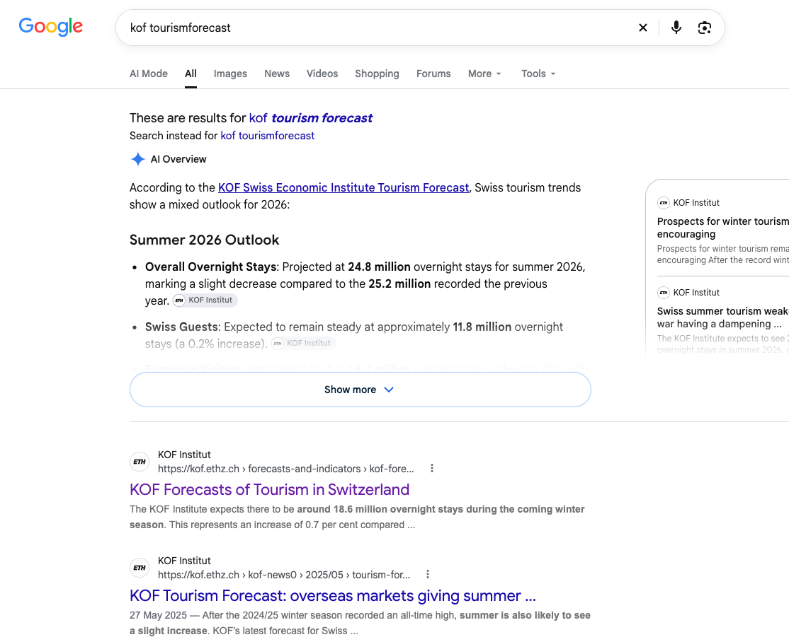
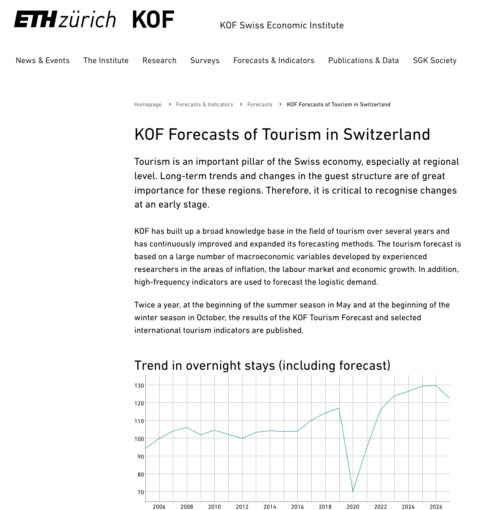
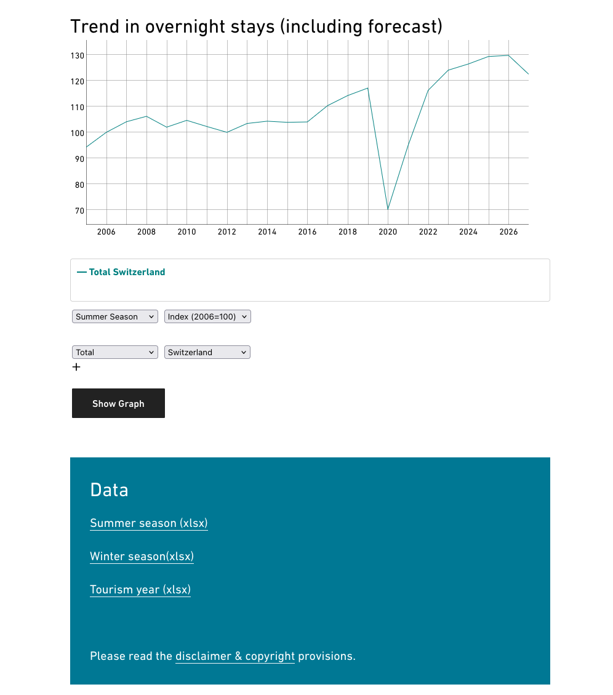
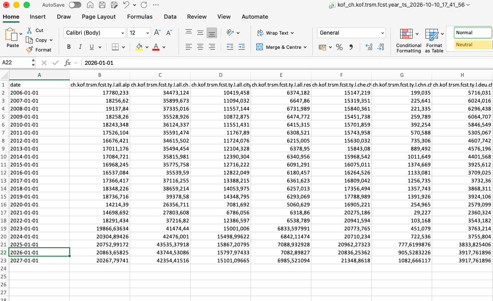

## Intro {visibility="hidden"}
```{r, hide=TRUE}
devtools::install_github("KOF-ch/kofdata")
# install.packages("kofdata")
```


## How do we get the data for this Plot?{.smaller}

<!-- Speaker Notes: 
Don't say anything about APIs yet. 
This is the KOF Economic Barometer, it's an economic index - monitoring the swiss economy is the goal, it is complex, but this captures it in just ONE number!
-> how? it's a collection of relevant data that helps capture the swiss economy, synthesised together
the kof baro, consists of 100s if not thousands of indivdual time series
Let's pretend, we want to reconstruct our own economic index  -->

```{r kofdata, echo=FALSE, message=FALSE, warning=FALSE, results='hide', fig.keep='all'}
suppressPackageStartupMessages(library(kofdata))
# devtools::install_github("opentsi/opentimeseries")
library(opentimeseries)

baro <- read_open_ts(series = "idx", remote_archive = "opentsi/ch.kof.barometer")
baro_start <- as.integer(format(min(baro$date), c("%Y", "%m")))

plot <- stats::ts.plot(
  ts(baro$value, start = baro_start, frequency = 12),
  gpars = list(
    xlab = "Year",
    ylab = "Value",
    main = "KOF Economic Barometer"
  )
)
plot
```

## About me 

- I took this course 5 years ago!
- Doing a Master in Data Science & minor in Economics at UZH
- Worked at KOF-ETH & built Opentsi

<!-- TODO: disclaimer, views are mine, not SNBs -->
<!-- Speaker Notes: I used to work in the institute that produces the data i just showed you -->

<!-- ## About the institute and its work

:::: {.columns}
::: {.column width="40%"}


{width="50%"}
:::

::: {.column width="60%"}
- from surveys to innovation to forecasting
- software, infrastructure and data publications with economic use cases.
- teaching PhD students to work with data & open source ecosystem. 
:::
::::  -->

## About Opentsi
<!-- TODO: reveal here? -->
- See [opentsi.github.io](https://opentsi.github.io/)
- vintages made public for research purposes, automatically maintained 
- plenty of API usage (for economic purposes) 


## What will you know by the end of this lecture?
- gain a better understanding of how APIs are used
- build your own mini wrapper
- learn to identify and understand the use of APIs in real-world contexts 

# Construct your own Economic Index 
<!-- 
Speaker Notes:

Brainstorming session: what kind of variables could be relevant for our economic index?

- what kind of data do you need to construct your own index that best represents Swiss Economic Activity?
- you need: gdp, energy consumption, demographic information, swiss market index (smi), etc. 
- how would you get all of this data?
-->
# Naive Way

## 
<!-- instead of BIP, use unemployment... -->
{fig-align="center"}

## 
{fig-align="center"}

## 
{fig-align="center"}
<!-- TODO: better quality for the excel -->
## 
{fig-align="center"}
<!-- Speaker Notes: it looks like this (wide format) because its nice to look at & humanly readable
long: machine friendly,  R plotting packages in prefer long

Here: I have to say that this is a "friendly example", not all data is excel, but px format - a format that many data providers prefer.

 -->

## Import & Clean Data {.smaller}
<!-- Speaker Notes:  
now that we have downloaded the data, we need to import and clean it, so we can use it for analysis
-->

::: {.panel-tabset}

### Code {.smaller}
```r 
library(readxl)
library(tidyr)

trsm <- read_xlsx("examples/kof_ch.kof.trsm.fcst.year_ts_2026-10-10_17_41_56.xlsx") 

# subset only the column that includes the series we want
total <- trsm[, c("date", "ch.kof.trsm.fcst.ty.l.all.ch.lg")]
names(total) <- c("Date", "Overnight_Stays") # rename cols

# convert overnight stays to num and date to date
total$Overnight_Stays <- as.numeric(total$Overnight_Stays)
total$Date <- as.Date(total$Date)

head(total, n = 10)
```

### Data

<!-- Speaker Notes:
don't focus too much on the tidyr, Aurélien will teach you about this, essentially: 
pivot from wide (excel format) to long format (easier to plot)

wide: values are horizontally oriented
long: values are vertically oriented

 -->
```{r import data}
library(readxl)
library(tidyr)

trsm <- read_xlsx("examples/kof_ch.kof.trsm.fcst.year_ts_2026-10-10_17_41_56.xlsx")

# subset only the column that includes the series we want
total <- trsm[, c("date", "ch.kof.trsm.fcst.ty.l.all.ch.lg")]
names(total) <- c("Date", "Overnight_Stays") # rename cols

# convert overnight stays to num and date to date
total$Overnight_Stays <- as.numeric(total$Overnight_Stays)
total$Date <- as.Date(total$Date)

head(total, n = 10)
```

:::

# API (wrapper) way

<!-- Speaker Notes: 
- getting unemployment data from above was hard because we weren't sure where to find what, and how it was gonna look (=which format) 

Using APIs, means everything is standardised - because of the HTTP protocol

- just a reminder: protocol means explicit way of behaving, we as humans have implicit protocol too (like how to behave), but machines have explicit protocols, you can see this with http (how the internet works)
 -->

##

<!-- Speaker Notes: 
HTTP dictates how data exchange happens on the web, and hence essential for APIs
- HTTP has main concept:
1. client - server 
2. communication through request & response
 -->
{fig-align="center"}

##
<!--
Speaker Notes:
not only does HTTP specify client server and request/response but:
 -  HTTP has 4 main request methods: GET, POST, DELETE, PUT 
-->
{fig-align="center"}

## 
<!-- 
Speaker Notes:
Putting the rest of the request together ->

- client makes a request to the server, specifying the following information:
- what ? -> HTTP verb
- where? -> base url  (location of server, repr. by the domain)
- which service -> endpoint (all data, specific data, all users, etc. -> usually last word is a verb or a plural noun)
- how (is the data represented)? -> params 
 -->
{fig-align="center"}


##
<!--
Speaker Notes: 

Important here is when looking at parameters, we need to differentiate between path param & query params - both used, you see them now so you don't get confused later 
- which API uses what is design preferences although there are cases where one is better than another (i.e. getting time series based on start & end params -> query param)
 -->
{fig-align="center"}

## 
<!-- 
Speaker Notes:
So, final request is sent to the server - we get a response

response consists of status (e.g. success) and response body 
 -->
{fig-align="center"}


##

<!-- 
Speaker Notes: 
when explaining this, encourage students to try out the link themselves -> how many IDs do we get when we use "poodle"
-->

## API wrappers {.smaller}
<!-- 
Speaker Notes:
API wrappers: simple program wraps the process of using the interface through dynamic URLs into a parameterized function

this is the most frequent way which you will encounter APIs, wrapped 
 -->

{fig-align="center"}


## opentsi API Wrapper for R {.smaller}
<!-- 
Speaker Notes:
next ingredient for our index: tourism demand (overnight stays in Switzerland, incl. the KOF forecast)

important here: after the read_open_ts() call, we're done with all the API stuff, all the searching for and getting data (what took us so long before)

no downloading, no excel, no cleaning - the data already comes in long format
-->
::: {.panel-tabset}

### code 
```r
# devtools::install_github("opentsi/opentimeseries")
library(opentimeseries)

# to inspect function
?read_open_ts

# to check which series you could use

# overnight stays in Switzerland (in thousands), incl. KOF forecast
tourism <- read_open_ts(
  # l = level, all = from all destinations, ch = overnight stays in all of switzerland, lg = logiernächte 
  series = "l.all.ch.lg",  
  remote_archive = "opentsi/ch.kof.trsm.fcst.ty"
)

tail(tourism, n = 10)
```

### output 
```{r opentsi api wrapper}
tourism <- read_open_ts(
  series = "l.all.ch.lg",
  remote_archive = "opentsi/ch.kof.trsm.fcst.ty"
)

tail(tourism, n = 10)
```

### plot
```{r opentsi api wrapper plot}
plot(
  tourism$date, tourism$value,
  type = "l",
  xlab = "Year",
  ylab = "Overnight stays (in thousands)",
  main = "Overnight Stays in Switzerland"
)
```

:::

# opentsi - under the hood {.smaller}
<!-- Speaker Notes:
where does the data in the opentsi archive come from?
every opentsi dataset is a github repository, and a robot (github action) regularly asks the original data provider for new data
one way in which we know how this works is to check out the github repository of the dataset: github.com/opentsi/ch.kof.trsm.fcst.ty
-->

## Let's take a closer look {.smaller}

<!-- Speaker Notes:
  let's go through this line by line: 
  we have the base url, the endpoint, the query params
  then perform, and specify how to get the response

  encourage students to open the link in the browser tab themselves
 -->
::: {.panel-tabset}

### Function

```r
# github.com/opentsi/ch.kof.trsm.fcst.ty/blob/main/R/process_data.R
fetch_ts <- function(ts_keys, valid_on = Sys.Date()) {
  request("https://tsdb-api.kof.ethz.ch/v2") |>   
    req_url_path_append("ts") |>                  
    req_url_query(                                
      keys = paste(ts_keys, collapse = ","),
      valid_on = as.character(valid_on),
      access_type = "public"
    ) |>
    req_perform() |>                              
    resp_body_json()                              
```
### Browser Output 

Try it out in your Browser:

[https://tsdb-api.kof.ethz.ch/v2/ts?keys=ch.kof.trsm.fcst.ty.l.all.ch.lg&access_type=public](https://tsdb-api.kof.ethz.ch/v2/ts?keys=ch.kof.trsm.fcst.ty.l.all.ch.lg&access_type=public)


### R Output

```{r fetch ts}
library(httr2)

fetch_ts <- function(ts_keys, valid_on = Sys.Date()) {
  request("https://tsdb-api.kof.ethz.ch/v2") |>
    req_url_path_append("ts") |>
    req_url_query(
      keys = paste(ts_keys, collapse = ","),
      valid_on = as.character(valid_on),
      access_type = "public"
    ) |>
    req_perform() |>
    resp_body_json()
}

str(fetch_ts("ch.kof.trsm.fcst.ty.l.all.ch.lg"), list.len = 5)
```

### Browser Output 2

{fig-align="center"}

:::


## Why APIs?

<!-- 
Speaker Notes:
maybe by now, you have some ideas as to why API's are useful... -->

- automation
- easier to fetch specific data (specify time, specific indicators)
- real time data
- API usage (often) so much easier than scraping & downloading & reading & cleaning!! (all-in-1)
- used everywhere!


# Exercises: Build your own API wrapper 

<!-- Speaker Notes:
why would you build your own API wrapper?
- do your research: does an API wrapper exist, does it suit your needs?
- doesn't exist yet, or current version is badly designed but cannot be contributed to (?)
- how? read documentation of API
- read httr2 documentation - what functions do we need to do this? 
 -->

## httr2 cheatsheet {.smaller}
<!-- 
Speaker Notes:
these are the most important functions in httr2, and how they translate to the diagram we saw above
 -->

| Category | Function | Description |
|-----------|-----------|-------------|
| **Request** | `request()` | Creates a new HTTP request object that defines the endpoint and method (e.g., GET, POST). |
| **Request** | `req_perform()` | Sends the built request to the server and *returns the response object*. |
| **Response** | `resp_body_json()` | Parses the response body as JSON and returns it as an R list. |
| **Response** | `resp_status()` | Retrieves the HTTP status from the response object. |

: {tbl-colwidths="[25,25,50]"}


## Exchange Rate API

- exchange Rate for tourism, exports 
- get daily CHF/EUR exchange rate 
<!-- - building our Economic Index
- Switzerland is a small, open economy - the value of the Swiss franc matters for exports and tourism
- for this, get the EUR/CHF exchange rate (daily reference rates of the European Central Bank) -->

## Read the API documentation {.smaller}
<!-- Speaker Notes:
this is a Swagger UI, a very common way of documenting APIs - you will see this a lot
show: the endpoints, open /latest, click "Try it out" (fields are locked before), for symbols click "Add item" and enter CHF, then "Execute"
-->
<!-- TODO: add screenshots of the Swagger UI (overview, /latest endpoint, try it out), replacing img/swagger_overview.png, img/historical_endpoint.png, img/try_out_endpoint.png -->

- API: [https://api.frankfurter.dev/v1](https://api.frankfurter.dev/v1/latest)
- documentation: [https://petstore.swagger.io/?url=https://api.frankfurter.dev/v1/openapi.json](https://petstore.swagger.io/?url=https://api.frankfurter.dev/v1/openapi.json)


## GET the latest Exchange Rate {.smaller}

::: {.panel-tabset}

###  Code 
```r
library(httr2)
# library(magrittr)
get_latest_rate <- function(base = "EUR", symbols = "CHF"){
  base_url <- "https://api.frankfurter.dev/v1/latest"
  final_url <- paste0(base_url, "?base=", base, "&symbols=", symbols)

  # perform API call with httr2
  req <- request(final_url) 
  resp <- req_perform(req)

  # if request is not successful
  if (resp_status(resp) != 200){
    message("The request was not successful")
  }
  else{
    return(resp_body_json(resp))
  }
}

get_latest_rate("EUR", "CHF")
```
### Data 
```{r exchange rate wrapper}
library(httr2)

get_latest_rate <- function(base = "EUR", symbols = "CHF") {
  # "https://api.frankfurter.dev/v1/latest?base=EUR&symbols=CHF"
  base_url <- "https://api.frankfurter.dev/v1/latest"
  final_url <- paste0(base_url, "?base=", base, "&symbols=", symbols)

  # perform API call with httr2
  req <- request(final_url)
  resp <- req_perform(req)

  # if request is not successful
  if (resp_status(resp) != 200) {
    message("The request was not successful")
  } else {
    return(resp_body_json(resp))
  }
}

get_latest_rate("EUR", "CHF")
```

:::


## How many Swiss francs did one euro cost on 31 December 2025? {.smaller}
- API documentation: [https://petstore.swagger.io/?url=https://api.frankfurter.dev/v1/openapi.json](https://petstore.swagger.io/?url=https://api.frankfurter.dev/v1/openapi.json)
- use the template to write a function **to get the exchange rate on a past date**

```r
library(httr2)

get_rate_on <- function(date, base = "EUR", symbols = "CHF"){

  base_url <- "..."
  final_url <- "..."

  # perform  API call with httr2
  req <- "..."(final_url) 
  resp <- "..."(req)

  # if request is not successful
  if (resp_status(resp) != 200){
    message("The request was not successful")
  }
  else{
    return(resp_body_json(resp))
  }
}
```
- copy this template at: [https://minnaheim.github.io/dh_guest_lecture_2026/presentation.html#/exercise-description](https://minnaheim.github.io/dh_guest_lecture_2026/presentation.html#/exercise-description)

# Sample Solution

## GET the Exchange Rate on a past Date {.smaller}

::: {.panel-tabset}

### Code 1

```r
library(httr2)

get_rate_on <- function(date, base = "EUR", symbols = "CHF"){
  # https://api.frankfurter.dev/v1/2025-12-31?base=EUR&symbols=CHF
  base_url <- "https://api.frankfurter.dev/v1"
  final_url <- paste0(base_url, "/", date, "?base=", base, "&symbols=", symbols)

  # perform  API call with httr2
  req <- request(final_url) 
  resp <- req_perform(req)

  # if request is not successful
  if (resp_status(resp) != 200){
    message("The request was not successful")
  }
  else{
    return(resp_body_json(resp))
  }
}

get_rate_on("2025-12-31")
```

### Code 2

```r
library(httr2)

get_rate_on <- function(date, base = "EUR", symbols = "CHF"){
  # https://api.frankfurter.dev/v1/2025-12-31?base=EUR&symbols=CHF
  req <- request("https://api.frankfurter.dev/v1") |>  # base url
    req_url_path_append(date) |>                       # path param
    req_url_query(base = base, symbols = symbols)      # query params

  # perform  API call with httr2
  resp <- req_perform(req)

  # if request is not successful
  if (resp_status(resp) != 200){
    message("The request was not successful")
  }
  else{
    return(resp_body_json(resp))
  }
}

get_rate_on("2025-12-31")
```


### Data

```{r}
library(httr2)

get_rate_on <- function(date, base = "EUR", symbols = "CHF") {
  # https://api.frankfurter.dev/v1/2025-12-31?base=EUR&symbols=CHF
  base_url <- "https://api.frankfurter.dev/v1"
  final_url <- paste0(base_url, "/", date, "?base=", base, "&symbols=", symbols)

  # perform  API call with httr2
  req <- request(final_url)
  resp <- req_perform(req)

  # if request is not successful
  if (resp_status(resp) != 200) {
    message("The request was not successful")
  } else {
    return(resp_body_json(resp))
  }
}

get_rate_on("2025-12-31")
```

::: 

## Other examples of APIs & API wrappers for economic data {.smaller}

- the [opentimeseries](https://github.com/opentsi/opentimeseries) R Package (for versioned, open time series)
- the [tidyfinance](https://www.tidy-finance.org/) API Wrappers 
- the [BFS](https://felixluginbuhl.com/BFS/) R package (for Swiss federal statistics)
- the [fredapi](https://pypi.org/project/fredapi/) Python Library (for US economic data)
- the [fredr](https://sboysel.github.io/fredr/) data from the Federal Reserve Economic Data (FRED) API R package
- [worldbank](https://data360.worldbank.org/en/api) Worldbank's Data360 API


## Ask me anything!  {.smaller}

- source code: [https://github.com/minnaheim/dh_guest_lecture_2026](https://github.com/minnaheim/dh_guest_lecture_2026)
- slides: [https://minnaheim.github.io/dh_guest_lecture_2026/presentation.html/](https://minnaheim.github.io/dh_guest_lecture_2026/presentation.html)
- contact me: [minnaemiliahagen.heim@uzh.ch](mailto:minnaemiliahagen.heim@uzh.ch)
